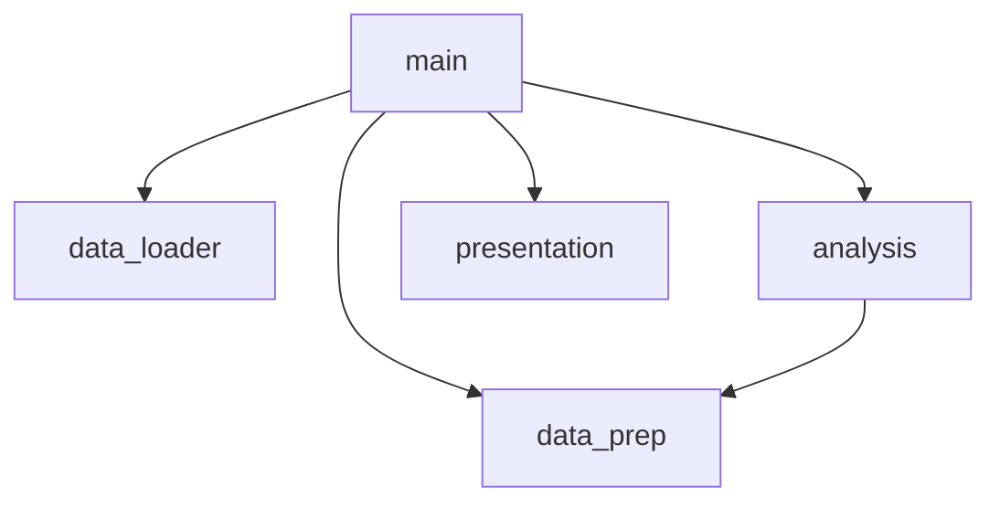

# Activity 2: Proposed Architecture

## Modules
Splitting it up by job, so everything in a module is there for the same reason:

- **`data_loader.py`**: reads the JSON file. `load_eva_data(path)`
- **`data_prep.py`**: skips bad records and turns the rest into clean EVA objects. It's the only place that knows the raw format. `prepare_records(raw)`, `duration_to_hours(text)`
- **`analysis.py`**: does the maths and returns numbers, no printing. `total_hours_for_country(evas, country)`, `stats_for_year(evas, year)`, `cumulative_hours(evas)`
- **`presentation.py`**: everything the user sees: prompts, prints and the graph. `ask_country()`, `ask_year()`, `show_country_total()`, `show_year_stats()`, `plot_cumulative()`
- **`main.py`**: just calls the others in order.

## Coupling example
Right now every loop parses the raw JSON itself (`eva.get("duration")`, `date_text[:4]`), so if the data format changes you have to edit all of them. After the split, only `data_prep` deals with the raw format.

## ADR-001: Split the script up by responsibility

**Context:** Everything's in one script, all mixed together, so you can't test or reuse any of it.

**Alternatives:** Keep one file and just wrap things in functions, split it by feature (country/year/graph), or split it by responsibility.

**Decision:** Split it by responsibility, like the modules above.

**Rationale:** One file isn't allowed. Splitting by feature would just mean each file still does its own loading, parsing and printing.

**Consequences:** It's easier to test and change, and new features slot in cleanly. The downside is more files than an app this small really needs.
